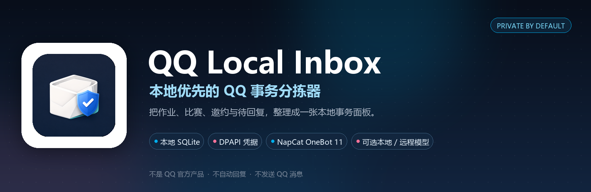
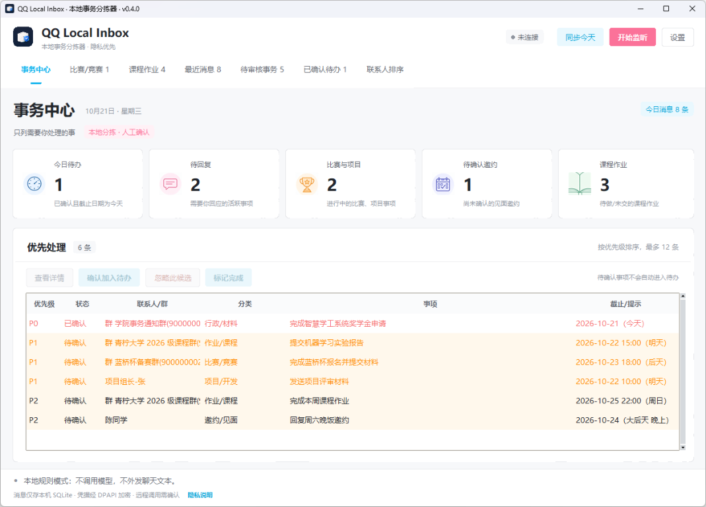
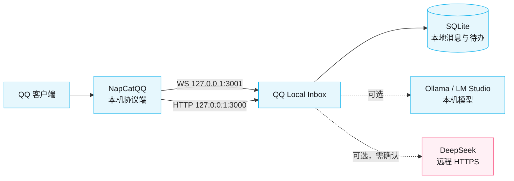

# QQ Local Inbox

<p align="center">
  
</p>

<p align="center">
  <a href="docs/USER_GUIDE.md"></a>
  <a href="docs/USER_GUIDE.md"></a>
  <a href="LICENSE"></a>
  <a href="PRIVACY.md"></a>
  <a href="docs/NAPCAT_SETUP.md"></a>
</p>

<p align="center">
  <strong>把 QQ 里需要你处理的事，整理成一张本地事务面板。</strong><br>
  作业 / 比赛 / 项目 / 邀约 / 待回复 · 本地 SQLite · 可选本地或远程模型
</p>

> 本项目不是腾讯 QQ 官方产品，也不隶属于 NapCatQQ。QQ 接入通过你自行安装并登录的 NapCatQQ 完成；不提供 QQ 登录、消息发送或自动回复能力。

## 界面预览

> 下图使用虚构演示数据，不包含真实聊天记录。群名、联系人和事项均为示例。

<p align="center">
  
</p>

## 核心能力

| 模块 | 说明 |
| --- | --- |
| 事务中心 | 今日待办、待回复、比赛与项目、待确认邀约四张卡片，按优先级列出最多 12 条事项 |
| 比赛/竞赛 | 独立页面集中展示待确认、已确认、已完成的比赛与竞赛事项 |
| 智能分拣 | 本地规则或 OpenAI 兼容模型；识别作业、比赛、项目、邀约、求助、材料、缴费、出行、就医 |
| 群聊降噪 | 只有 @你、群公告/管理员要求、明确截止通知、比赛信息才进入候选；闲聊和广告只本地归档 |
| 重复合并 | 同一会话、同一文本、同一截止日的活跃待办自动合并 |
| 凭据与隐私 | API Key / NapCat Token 用 Windows DPAPI 加密；远程 API 必须显式确认 |
| 自动同步 | 启动自动连接 NapCat，并同步最近 50 个会话中今天有活动的内容 |
| 历史导入 | 通过本机 NapCat HTTP 接口手动导入指定好友/群的最近 N 条文本 |

## 数据流与隐私边界



远程 API 只接收消息文本与最少上下文（私聊/群聊、是否 @ 你、发送者角色），不发送群名称、图片、文件、语音或原始事件 JSON。规则模式和本机模型模式不会把聊天文本发到公网。

## 文档

| 文档 | 内容 |
| --- | --- |
| [使用教程与注意事项](docs/USER_GUIDE.md) | 安装、NapCat、首次配置、日常操作、分拣规则、数据清理、常见问题 |
| [API 接入、费用与本地模型](docs/API_AND_MODELS.md) | DeepSeek/Ollama/LM Studio 接入、Token 估算、峰谷价格、本地模型推荐 |
| [NapCat 本机连接配置](docs/NAPCAT_SETUP.md) | WebSocket/HTTP 配置、Token、故障排除 |
| [隐私与安全检查清单](PRIVACY.md) | 本地存储、凭据、远程外发、数据清除 |
| [安全策略](SECURITY.md) | 漏洞报告方式、范围、数据安全与已知限制 |
| [第三方组件与引用说明](THIRD_PARTY_NOTICES.md) | NapCatQQ、OneBot 11、websocket-client、DeepSeek、Ollama、LM Studio 与免责声明 |

## 隐私设计

- 默认使用本地规则，不调用模型；可显式切换到“大模型 API”模式。
- 默认只允许连接 `127.0.0.1`、`localhost` 或 `::1` 的 OpenAI 兼容端点（例如 Ollama、LM Studio）。远程端点只允许 HTTPS，必须勾选知情确认并填写 API Key；使用 DeepSeek 时消息文本会发送给 DeepSeek，同时附带最少上下文（私聊/群聊、是否 @ 你、发送者角色），不发送群名称。
- 只允许连接本机 WebSocket 和本机 NapCat HTTP 地址，拒绝远程主机与地址中内嵌的账号密码。
- Access Token / API Key 使用 Windows DPAPI 按当前 Windows 用户加密保存在 `secrets.dat`，不写入 `settings.json`、日志或 SQLite 明文；设置文件只保存端点、模型与是否允许远程 API。
- 启动时默认自动连接 NapCat，并自动同步今天的最近会话消息；今日同步先用本地规则预筛，只有候选/待回复文本才会交给远程模型。
- 群聊降噪：只有直接 @ 你、群主/管理员或群公告要求全体成员执行、带明确截止时间的作业/报名/提交通知、比赛/竞赛公开信息才进入候选；群内普通提问、讨论、玩笑、招募/代课/家教广告只本地入库，不生成待办。
- 同一会话、同一文本、同一截止日的活跃待办会自动合并，避免实时与今日同步重复创建；历史重复候选在启动时合并。
- 所有凭据可在界面底部“清除已保存凭据”一键删除；清除后不会删除消息与待办。
- 只保留消息事件必要字段与纯文本；不保存完整原始事件 JSON，不下载/分析图片、文件、语音等附件。
- 历史记录只在点击“导入历史”后，从本机 NapCat HTTP 接口读取你指定会话的最近 N 条文本；不会自动拉取，也不会读取其他会话。
- 默认只接收私聊；群消息默认关闭。打开“接收群消息”后，实时群聊与今日同步使用同一范围：普通群聊只本地规则归档，只有候选/待回复文本才交给模型。
- 不发送 QQ 消息、不自动回复、不自动接受邀约。
- 本地数据默认位于 `%LOCALAPPDATA%\QQLocalInbox\`，包括 `inbox.sqlite3`、不含 Token/Key 的 `settings.json`，以及经 DPAPI 加密的 `secrets.dat`。

> QQ 本身以及 NapCat 的通信进程仍需要联网连接 QQ 服务。我们能约束的是此程序如何处理聊天消息，而不是保证整个 QQ 环境零网络流量。部署前应阅读 NapCat 当前版本的官方说明与隐私/安全行为。本机模型服务（Ollama/LM Studio）与远程服务（如 DeepSeek）是否记录请求、如何使用数据，由对应服务的配置与隐私政策决定。

## 第三方与免责声明

本项目不是腾讯 QQ 官方产品，也不隶属于 NapCatQQ、DeepSeek、Ollama 或 LM Studio。QQ 接入通过你自行安装并登录的 NapCatQQ 完成；本项目不提供 QQ 登录、消息发送或自动回复能力。QQ 接入需遵守腾讯 QQ 用户协议、NapCat 上游许可和当地法律，第三方协议端可能存在账号风险。

依赖、许可证与引用说明见 [THIRD_PARTY_NOTICES.md](THIRD_PARTY_NOTICES.md)。

## 快速开始

1. 安装 Python 3.11/3.12（勾选 Tcl/Tk），并安装 NapCatQQ、登录 QQ。
2. 在项目目录安装依赖：

   ```powershell
   Set-ExecutionPolicy -Scope Process Bypass
   .\install.ps1
   ```

3. 按 [NapCat 配置](docs/NAPCAT_SETUP.md) 开启本机 WebSocket Server（`127.0.0.1:3001`）；需要同步今天或导入历史时，再开启本机 HTTP Server（`127.0.0.1:3000`）。
4. 双击 `run.bat`，点击“连接设置”：
   - 先用“本地规则”跑通，不调用模型；
   - 需要语义分析时，切换到“大模型 API”，选择本机 Ollama/LM Studio 或显式确认后的 DeepSeek；
   - 点击“开始监听”。

| 分析方式 | 适用场景 | 是否外发 |
| --- | --- | --- |
| 本地规则 | 高频消息、先跑通流程 | 否 |
| 本机模型 | 比规则更懂语义，又不想上云 | 只到本机回环地址 |
| 远程模型 | 需要更强模型，接受费用与隐私政策 | 文本 + 最少上下文 |

## Windows 安装

要求：Windows 10/11 x64、Python 3.11 或 3.12（含 Tcl/Tk）和能访问 PyPI 下载 `websocket-client` 的网络。联网用于首次安装依赖；规则模式运行时不调用模型。本机模型模式只访问你配置的本机端点；DeepSeek 等远程模式需显式勾选知情确认。

1. 下载并解压项目目录。
2. 右键 PowerShell，进入解压目录。
3. 执行：

   ```powershell
   Set-ExecutionPolicy -Scope Process Bypass
   .\install.ps1
   ```

4. 双击 `run.bat`。
5. 按 `docs/NAPCAT_SETUP.md` 配置 NapCat 的 OneBot 11 WebSocket Server；如需要导入历史记录，再开启本机 HTTP Server。

如果你不想在每次启动时连接互联网安装依赖，可以先在可联网环境安装/构建，再按组织的离线分发方式传递依赖包；不要为省事把消息转发到云端分析服务。

## 使用

1. 确认 NapCat 已经运行，并配置 `ws://127.0.0.1:3001`（端口以实际配置为准）。
2. 首次启动应用，点击右上角“连接设置”，输入 OneBot Access Token（NapCat 未设置 Token 时可留空），选择“本地规则”或“大模型 API”，点击“开始监听”。Token/Key 会用 DPAPI 加密保存；之后启动会按设置自动连接，不需要重复输入。
3. 应用会按设置自动同步今天的最近会话消息（默认开启）；开启群消息后，实时群聊也会进入“最近消息”。命中行动规则的消息会自动出现在“待审核事务”和首页“优先处理”。
4. 在“事务中心”或“待审核事务”查看原消息，点击“确认加入待办”或“忽略此候选”。已确认项目可标记完成。“比赛/竞赛”页集中罗列所有比赛、竞赛事项（待确认/已确认/已完成），可直接查看详情、确认、忽略或标记完成。
5. 如需处理更早的聊天记录，点击“导入历史”，填写本机 NapCat HTTP 地址（默认 `http://127.0.0.1:3000`）、HTTP Access Token，选择好友/群与条数后导入。导入使用当前分析模式，导入的候选仍需人工确认；远程模式下对话框会提示每条导入文本会发送给服务商。
6. 点击“同步今天”可手动重跑今日同步。停止监听时点击“停止监听”或直接关闭窗口。需要修改连接设置时，先停止监听，或点击“连接设置”展开面板。

### 使用 DeepSeek（远程 API）

1. 在“大模型 API”模式选择 `DeepSeek` 预设；Endpoint 自动填 `https://api.deepseek.com/v1/chat/completions`，模型自动填 `deepseek-flash`。
2. 勾选“我知晓远程 API 会把消息文本发送给该服务商”。
3. 在 API Key 输入框填入 DeepSeek Key；Key 会用 Windows DPAPI 加密保存到当前 Windows 用户。
4. 点击“开始监听”。私聊新消息逐条送 DeepSeek 分析；群聊先做本地规则和上下文预筛，普通讨论、提问、广告只本地入库，只有 @你、群公告/管理员要求、明确截止通知或比赛信息才送模型。发送给远程服务的只有消息文本与最少上下文（私聊/群聊、是否 @ 你、发送者角色），不发送群名称。
5. Endpoint、模型名称与远程知情确认保存在 `settings.json`；Key 只以 DPAPI 加密形式保存在 `secrets.dat`。可在底部“清除已保存凭据”删除 Key/Token 并取消远程确认。
6. 本机模型与远程模型可以随时切换；切换后停止再开始监听即可，不需要重新输入已保存的 Key。

程序不会自动登录 QQ；启动时可同步今天最近会话，但不会补抓更早历史；不会自动替你答应邀约或回复联系人。连接中断期间的消息可能漏收，实时链路不追补历史记录；更早的记录只能由你手动导入。

## 费用与本地模型

DeepSeek 当前官方模型为 `deepseek-flash` 与 `deepseek-v4-pro`；应用预设使用 `deepseek-flash`，并默认关闭思考模式、限制分类输出长度。实测同一条短消息的输出 token 从 301 降到 81。

### DeepSeek 价格速览（2026-10-19，元 / 百万 token）

| 模型 | 高峰输入（缓存未命中） | 高峰输出 | 空闲输入 | 空闲输出 |
| --- | ---: | ---: | ---: | ---: |
| deepseek-flash | 2.00 | 8.00 | 1.00 | 4.00 |
| deepseek-v4-pro | 9.00 | 27.00 | 4.50 | 13.50 |

高峰为北京时间周一至周五 09:00-12:00、14:00-18:00，其余时间为空闲。完整 Token 估算、单次/每日/每月费用示例和缓存说明见 [API 接入、费用与本地模型](docs/API_AND_MODELS.md)。

### 本地模型速选

| 显存/硬件 | 推荐档位 | 说明 |
| --- | --- | --- |
| 4-6GB | 3B-4B，Q4 | 能跑，JSON 稳定性较弱 |
| 8GB | 7B-8B，Q4_K_M | 推荐的本地最低档 |
| 12-16GB | 14B，Q4_K_M | 中文语义更稳 |
| 24GB | 32B，Q4_K_M | 本地质量最好，速度较慢 |
| 仅 CPU | 3B-4B，Q4 | 可用但慢，高消息量建议规则模式 |

中文分类优先 Qwen2.5 / Qwen3 指令模型；Ollama 与 LM Studio 的配置步骤、模型标识和 JSON 模式注意事项见 [API 接入、费用与本地模型](docs/API_AND_MODELS.md)。

群聊本地预筛、关闭群消息、使用规则模式或本机模型，都能显著减少远程调用与费用。

## 测试

```powershell
.\.venv\Scripts\python.exe -m unittest discover -s tests -v
```

无需 QQ 登录即可运行规则、本机地址保护、远程端点知情确认、DPAPI 凭据加密、日期推算、NapCat 客户端（模拟 HTTP）、今日同步、SQLite 流程与仪表盘统计测试。测试使用临时数据目录，不会触碰真实的 `%LOCALAPPDATA%\QQLocalInbox\`。

## 打包成 EXE（可选）

```powershell
.\.venv\Scripts\python.exe -m pip install pyinstaller
.\.venv\Scripts\pyinstaller.exe --noconfirm --clean --windowed --name QQLocalInbox --collect-all websocket --hidden-import=tkinter --hidden-import=tkinter.ttk launcher.py
```

生成文件在 `dist\QQLocalInbox\` 或 PyInstaller 当前版本对应目录。第一次建议使用 onedir 目录包，方便排查依赖。打包产物不包含你的 QQ Token 或消息数据库。

## 重要限制

- `rules` 模式是可解释的关键词规则，不是 AI 语义理解；`api` 模式使用你指定的 OpenAI 兼容 Chat Completions 接口，默认本机，远程需显式确认。
- 本机模型模式只把消息发送到本机端点；DeepSeek 等远程模式会把消息文本和最少上下文发送给服务商。API 分析失败时，消息会用本地规则入库，不会自动改用其他服务商。
- 模型需兼容 OpenAI Chat Completions，并返回可解析 JSON；程序会容忍 Markdown JSON 代码块和 JSON 前后的说明文字。仍无法解析时会显示分析失败，并保留消息与本地规则结果，可切回规则模式。
- `今天/明天/周末` 会按消息发送时间推算为具体日期，但“周末/下周/本月”等表达仍有歧义；推算结果会显示为 `YYYY-MM-DD（相对标签）`，最终以人工核对为准。
- “联系人重要性”目前体现在待处理事项优先级与排序分上；不会依据聊天频率做联系人价值画像。
- 今日自动同步读取最近 50 个会话中今天有活动的会话，每会话最多 30 条、总计 300 条；先用本地规则预筛，只有候选/待回复文本发送给模型。该上限与预筛策略见 `src/sync.py`。
- 凭据加密依赖 Windows DPAPI：同一 Windows 用户可解密，其他账户不能；如果移动数据目录到另一台电脑或另一个用户，需要重新输入凭据。若 Key 曾出现在聊天/截图中，仍建议在服务商控制台轮换。
- 桌面快捷方式默认指向本机 `.venv\Scripts\pythonw.exe`；移动项目目录后需要重建快捷方式。
- 当前版本无消息编辑监听、撤回同步、文件下载、OCR、语音转写、桌面通知或定时提醒。
- 本地 SQLite 当前没有应用层字段加密；请保护 Windows 账户，启用 BitLocker/设备加密，并确保备份加密。清空功能会尝试 checkpoint/VACUUM，但不保证清除 SSD 磨损均衡、系统快照或既有备份中的所有残留。
- 历史导入依赖 NapCat HTTP Server，一次只读取所选会话最近 N 条文本；不下载媒体。导入文本按当前分析模式处理，远程模式下会发送给服务商；中途失败时已导入数据会保留，重试会按消息去重。
- 若 NapCat 的 WS/HTTP Token 为空，程序允许留空连接，但任何本机进程都可能访问这些端口；共享电脑上建议为 NapCat 设置 Token 并在程序中填写。

## 技术结构

- `src/app.py`：Tkinter 主窗口、连接生命周期、事件队列、人工审核工作流
- `src/theme.py`：共享调色板、圆角控件、导航与状态组件
- `src/dashboard.py`：事务中心计数卡与优先处理列表
- `src/import_dialog.py`：NapCat 历史消息导入对话框与后台导入流程
- `src/napcat_api.py`：本机 NapCat OneBot HTTP API 客户端（列表/历史/错误归类）
- `src/localnet.py`：本机地址白名单与远程端点判断
- `src/timeparse.py`：按消息发送时间推算具体截止日期、时刻与相对标签
- `src/sync.py`：今日最近会话同步、本地规则预筛与去重
- `src/secret_store.py`：Windows DPAPI 加密保存/读取/清除凭据
- `src/onebot.py`：本机 WebSocket 接收、可选 Token、事件字段白名单与文本过滤
- `src/classifier.py`：本地规则分类、群聊上下文降噪和优先级评分
- `src/api_classifier.py`：本机或需确认的远程 OpenAI 兼容模型分类、JSON 容错与字段校验
- `src/store.py`：SQLite 本地消息、事务候选、状态、截止日期、去重与仪表盘统计
- `src/config.py`：仅持久化非秘密设置；远程端点可保存，Key 与确认状态分离管理
- `assets/icon.ico`：应用与桌面快捷方式图标
- `docs/USER_GUIDE.md`：使用教程与注意事项
- `docs/API_AND_MODELS.md`：API 接入、费用与本地模型推荐
- `docs/NAPCAT_SETUP.md`：NapCat WebSocket / HTTP 配置和故障排除
- `THIRD_PARTY_NOTICES.md`：第三方组件、NapCat/QQ 引用与免责声明
- `SECURITY.md`：漏洞报告方式、范围与数据安全说明
- `PRIVACY.md`：安全检查清单
