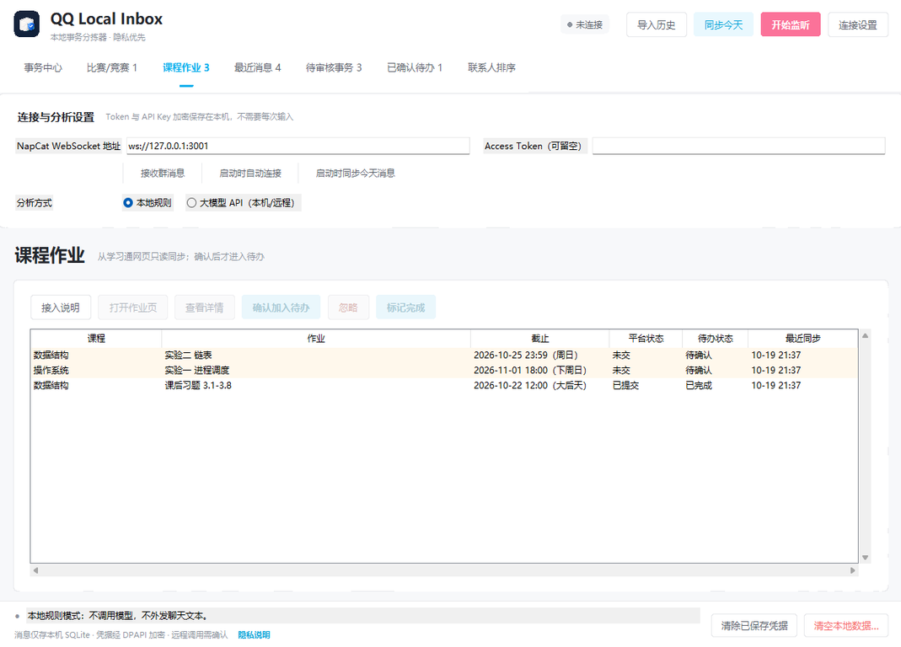

# 学习通作业接入（只读桥）

> 这是一个可选的本地功能。它通过你在浏览器中已经登录的学习通页面读取作业元数据，不保存学习通账号或密码，也不会自动提交作业。

## 它能做什么

- 读取作业的课程名、作业标题、截止时间、平台状态（未交/已交/已批阅等）和作业链接。
- 把作业同步到本机 `QQ Local Inbox` 的“课程作业”页。
- 支持两种同步方式：
  - **同步当前页**：打开某门课程的作业列表页后，一键同步当前页。
  - **全部课程**：在学习通“我学的课”页面，尝试逐门课程读取作业列表。
- 同一个作业重复同步会更新标题、截止时间和状态，不会重复创建。
- 学习通显示“已交/已提交/已批阅”的作业会自动标为完成；你手动确认或忽略的决定会保留。

## 它不做什么

- 不读取学习通账号、密码、Cookie 或附件。
- 不下载作业文件、答案、图片或视频。
- 不自动打开、答题、提交、签到或回复。
- 不绕过登录、验证码或平台权限。
- 不保证覆盖所有页面布局；页面结构变化时可能需要更新脚本。

## 界面示例

> 下图使用虚构演示数据，不包含真实课程、作业或链接。

<p align="center">
  
</p>

## 前置条件

1. Windows 上已能正常运行 `QQ Local Inbox`。
2. 浏览器已安装 [Tampermonkey](https://www.tampermonkey.net/) 或 Violentmonkey。
3. 浏览器中已登录学习通，且能看到课程作业列表。
4. 使用前自行确认学校和学习通平台的相关规定允许这种只读同步。

> 学习通没有面向学生的公开官方 API。本功能依赖网页结构进行只读提取，属于尽力而为的本地辅助工具，不代表学习通官方支持。

## 首次接入

1. 启动 `QQ Local Inbox`，打开左侧“课程作业”页。
2. 点击“接入说明”。
3. 对话框会显示本机接收服务状态，例如：
   ```text
   本机接收服务已启动：127.0.0.1:8765
   ```
   默认端口是 `8765`；如果被占用，程序会自动尝试后续端口，对话框中显示实际端口。
4. 点击“复制脚本”。
5. 打开 Tampermonkey 管理面板，新建脚本，粘贴并保存。
6. 打开学习通并登录：
   - 进入某门课程 → 作业列表 → 页面右下角出现“QQ Local Inbox”面板。
   - 或在“我学的课”页面使用“全部课程”。
7. 点击“同步当前页”或“全部课程”。
8. 回到程序“课程作业”页，作业会出现在列表中；确认后才进入待办。

## 面板按钮

| 按钮 | 作用 |
| --- | --- |
| 同步当前页 | 读取当前页面能识别到的作业并发送到本机 |
| 全部课程 | 从“我学的课”页面发现课程入口，逐门读取作业列表 |
| 预览识别结果 | 只显示识别到的数量和前三条，不发送；识别不准时用于排查 |
| 打开作业页时自动同步 | 默认开启；页面加载后若识别到作业会自动发送一次 |

自动同步只写入本机，不会提交作业。可以在面板中取消勾选。

## 数据边界

发送到本机的字段只有：

```json
{
  "course_id": "课程标识",
  "course_name": "课程名",
  "assignment_id": "作业标识",
  "title": "作业标题",
  "due_at": "截止时间",
  "status": "平台状态",
  "url": "作业链接"
}
```

这些字段保存在本地 SQLite 的 `course_assignments` 表。作业链接可能包含 `courseId`、`classId`、`cpi`、`enc` 等课程定位参数，但不会包含账号密码。

本机接收服务：

- 只监听 `127.0.0.1`，不接受外部主机连接。
- 每次请求必须携带脚本中嵌入的随机令牌。
- 限制请求体大小和单次作业数量。
- 不记录作业内容或请求正文。
- 令牌使用 Windows DPAPI 加密保存在 `secrets.dat`；脚本本身也包含该令牌，请不要把脚本发给别人。

## 常见问题

**页面右下角没有面板**

- 确认 Tampermonkey 已启用该脚本。
- 确认当前地址是 `chaoxing.com` 域名下的页面。
- 学习通部分页面使用 iframe；如果面板始终不出现，直接打开课程作业列表地址后再试。
- 刷新页面。

**“没有识别到作业”**

- 先点“预览识别结果”；如果数量为 0，说明当前页不是作业列表，或页面结构未被识别。
- 尝试进入具体课程的“作业”列表页再同步。
- 学习通改版后，选择器可能失效；需要更新 `assets/chaoxing_bridge.user.js`。

**“无法连接本机程序”**

- 确认 `QQ Local Inbox` 正在运行。
- 打开“接入说明”，确认接收服务显示“已启动”，并核对端口。
- 如果程序重启后端口变化，需要重新复制脚本。

**“访问令牌无效”**

- 脚本是在重置令牌或清除凭据之前复制的。
- 打开“接入说明”，重新复制并粘贴最新脚本。

**“全部课程”读取失败**

- “我学的课”页面的课程入口可能不是普通链接，或课程需要额外权限。
- 改用逐门课程打开作业页后“同步当前页”。

**同步后没有进入待办**

- 课程作业默认是“待确认”；在“课程作业”页选中后点“确认加入待办”。
- 学习通显示已交/已批阅的作业会自动标为完成，不再计入待办。

## 关闭或卸载

- 在 Tampermonkey 中禁用/删除脚本。
- 在程序“课程作业”页不再同步即可；已经同步的记录可在底部“清空本地数据…”中删除。
- 底部“清除已保存凭据”会重置学习通接入令牌，旧脚本随之失效。

## 风险与限制

- 学习通页面结构和接口可能随时变化，脚本不保证长期可用。
- 读取依赖你当前浏览器的登录状态；登录失效后需要重新登录学习通。
- 自动化访问可能受平台用户协议限制，请自行确认并承担相应风险。
- 程序只做本地整理，不替代学习通中的官方截止时间、提交状态和成绩记录；重要作业请以学习通页面为准。
